# ICC JEJU 문서·AI 플랫폼 — 관리자 매뉴얼 (v0.7)

관리자·기록물 담당자용입니다. 설치·보안·연동의 상세는 `docs/PORTABLE.md`, `docs/SECURITY.md`, `docs/INTEGRATION.md`, `docs/API.md` 를 보세요.

## 1. 역할
| 역할 | 할 수 있는 일 |
|---|---|
| 관리자(admin) | 설정·연동·감사·사용자·폐기 승인. **문서 내용은 읽지 못함** (권한 관리만) |
| 기록물 담당자(records) | 분류표·폐기 신청·개인정보 점검·대장. 문서 본문은 보지 못함 |
| 일반 사용자 | 권한 있는 문서만 |

## 2. 기록물 관리 (분류·폐기·개인정보)
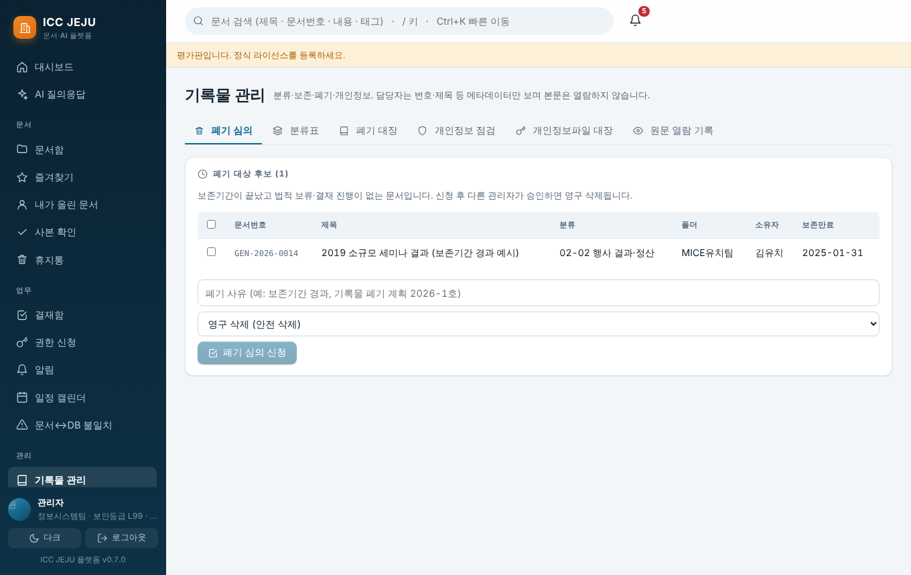

- **분류표**: 코드·보존연수(99=영구) 지정, CSV 가져오기(한 줄이라도 틀리면 전체 취소).
- **폐기 심의**: 보존기간이 끝났고 법적 보류·결재 진행이 없는 문서가 후보. 담당자가 신청 → **다른 관리자**가 승인(본인 신청 건은 승인 불가). 방식은 **영구 삭제(저장 파일 덮어쓰기)** 또는 **비식별화**. 승인된 건마다 **파기확인서**(검증 해시 포함)를 출력할 수 있고 **폐기 대장**(CSV)에 남습니다.
- 신청 이후 문서가 바뀌면 그 건은 자동 제외됩니다.

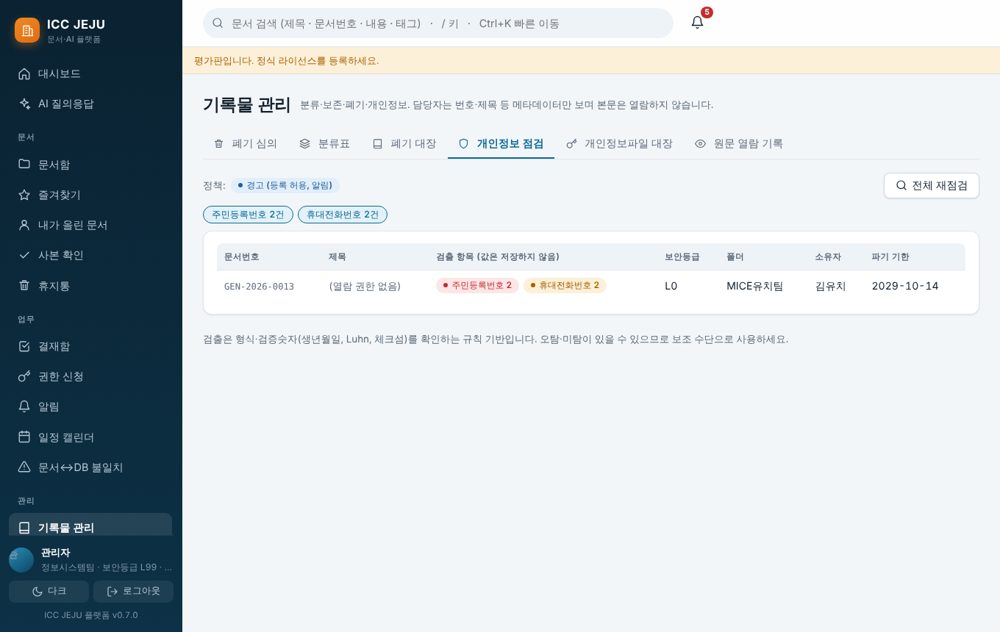

- **개인정보 점검**: 형식·검증숫자 기반 검출(주민/외국인등록·카드·여권·연락처·이메일), 값은 저장하지 않고 건수만 기록. 보존기간이 끝난 개인정보 포함 문서를 배너로 알립니다. 정책(`dlp.mode`): warn / block / raise_level / off.
- **원문 열람 기록**: 사용자가 사유를 입력하고 원문을 본 내역.

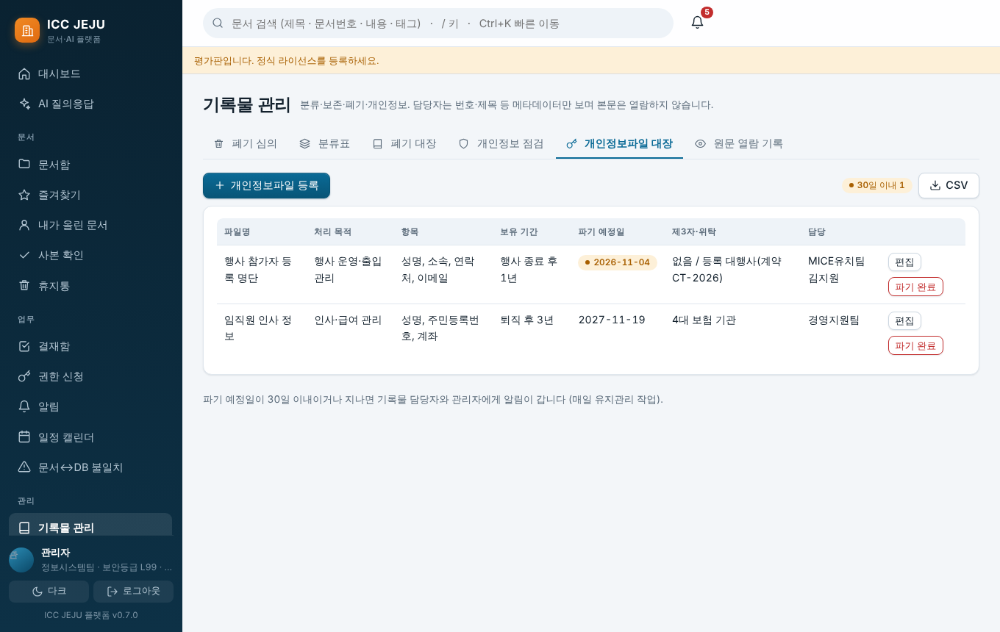

- **개인정보파일 대장**: 파일명·목적·근거·항목·보유기간·파기 예정일·제3자 제공·위탁·담당. 파기 기한 30일 전부터 알림, CSV 내보내기.

## 3. AI 신뢰성 센터
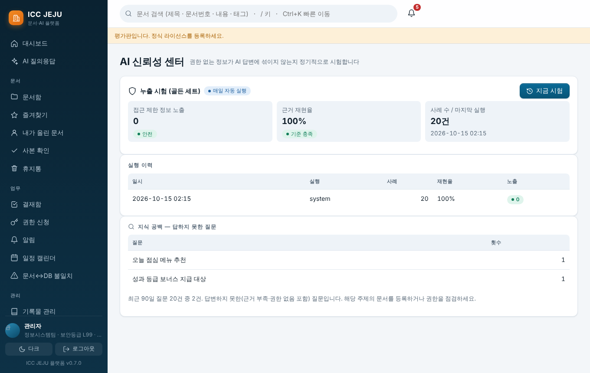

골든 세트(`eval.golden`)로 "권한 없는 정보가 답변에 섞이는지"를 시험합니다. **노출 0건이 합격**이며 매일 자동 실행(`eval.daily`)합니다. 노출이 감지되면 관리자에게 알림이 갑니다. 하단 "지식 공백"은 AI가 답하지 못한 질문 목록입니다.

## 4. 백업 · 라이선스 · 모니터링
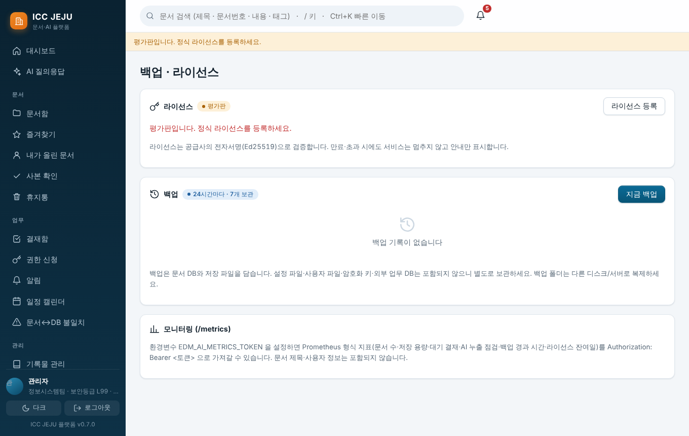

- **백업**: `backup: {"dir": "backups", "every_hours": 24, "keep": 7}`. 실행마다 무결성을 검증하고 오래된 것을 지웁니다. 문서 DB·저장 파일만 포함하므로 설정·users.json·암호화 키는 별도 보관, 백업 폴더는 다른 디스크/서버로 복제하세요. 복구는 `edm-ai restore`.
- **라이선스**: 공급사가 발급한 `license.json` 을 "라이선스 등록"에 붙여 넣습니다(Ed25519 서명 검증). 만료·사용자 초과는 배너로 안내하며 서비스는 계속됩니다. 공급사는 `tools/license_tool.py` 로 발급합니다(개인키는 공급사 PC에서만).
- **/metrics**: 환경변수 `EDM_AI_METRICS_TOKEN` 설정 시 Prometheus 지표 제공(건수만).

## 5. 저장소·메일 연동 (화면에서 직접 연결)

"연결 추가" ▸ 정보 입력 ▸ **연결 테스트**(성공/실패 사유 표시) ▸ 저장 ▸ "지금 동기화"(메일은 "지금 수집") 순서입니다. 설정 파일을 직접 고칠 필요가 없습니다.

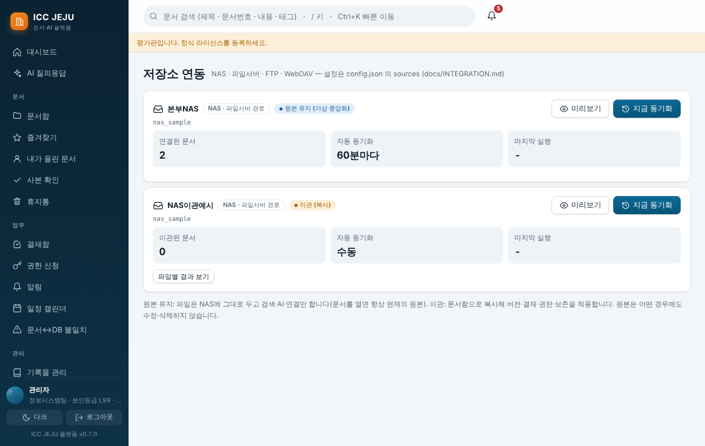

NAS·파일서버·FTP·WebDAV를 "원본 유지(색인만)" 또는 "이관(복사)"으로 연결합니다. 미리보기(드라이런) 후 동기화하세요. 원본은 수정·삭제하지 않습니다.

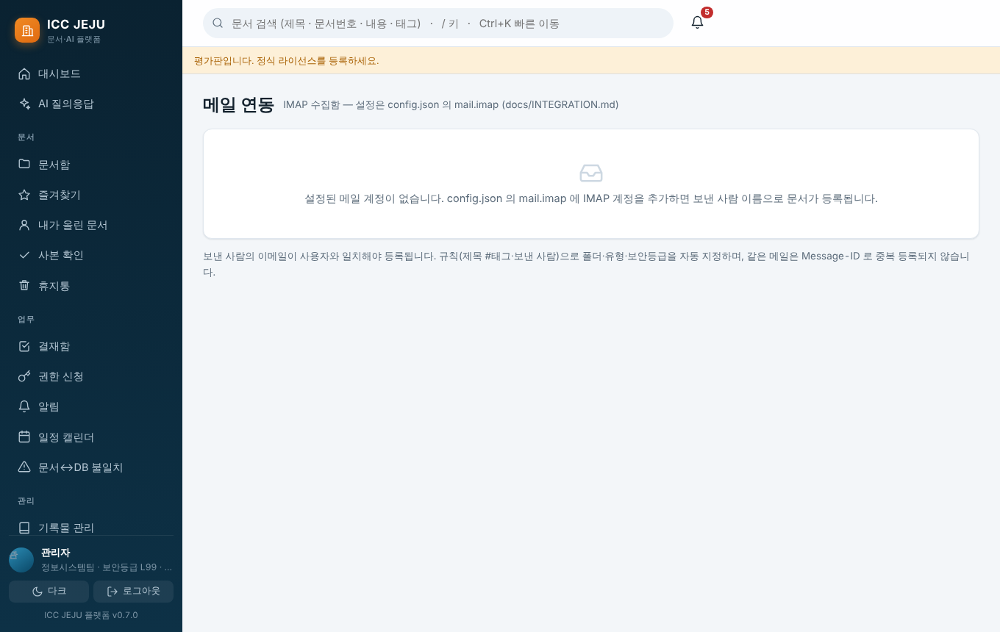

IMAP 수집함: 보낸 사람 이름으로 문서 등록, 규칙으로 폴더·유형·등급 지정, 중복 방지. 설정은 `mail.imap`.

## 6. 외부 연동 (API 키·웹훅·그룹웨어)
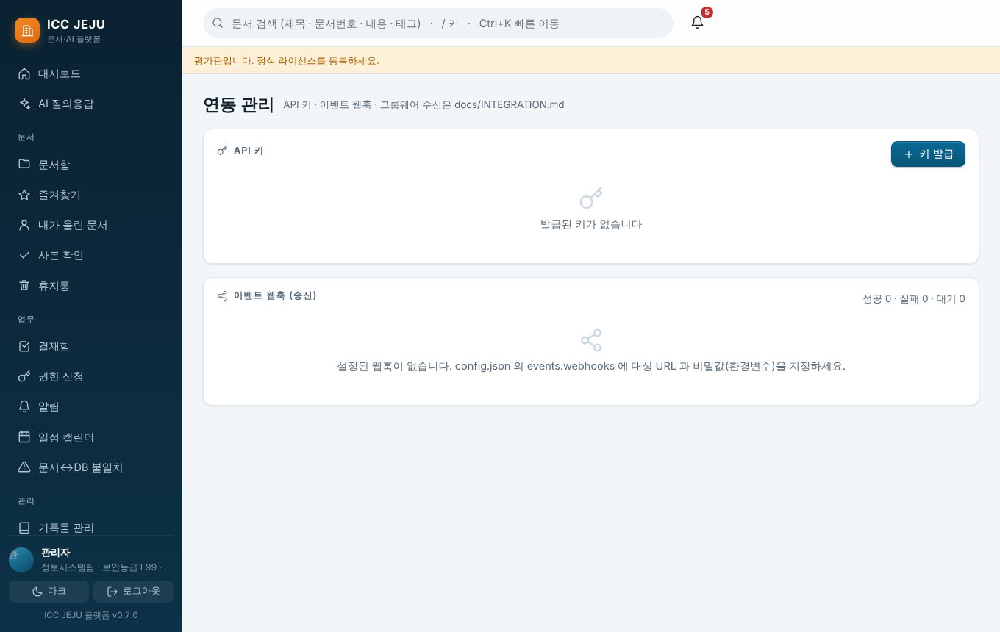

API 키(조회/등록 범위, 관리 기능 불가), 이벤트 웹훅(HMAC 서명), 그룹웨어 결재 완료 수신. 상세는 `docs/INTEGRATION.md`.

## 7. 리포트·문서유형·감사
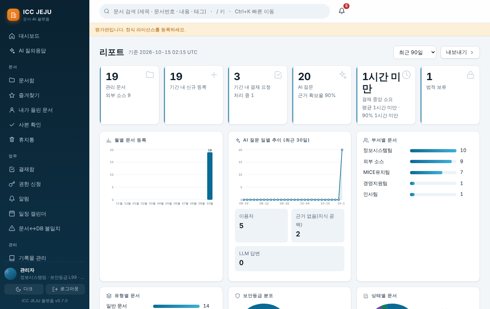
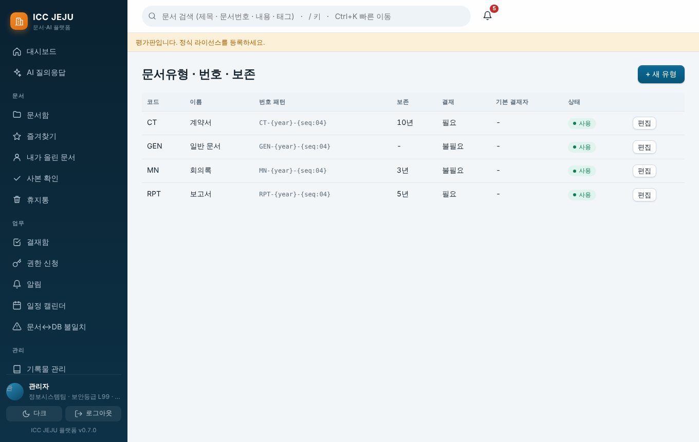
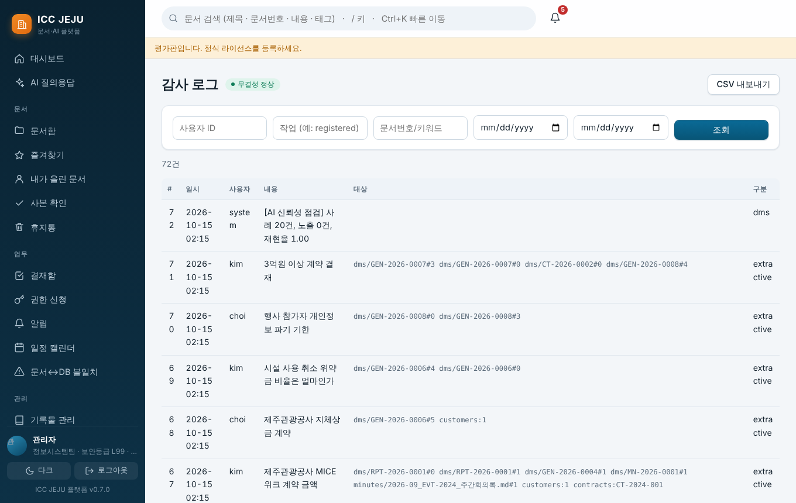

- **문서유형**: 번호 패턴·보존·기본 결재자·**사용자 정의 항목**(`키|이름|형식|필수|보기`, 형식: text/number/date/select). 항목은 등록·수정 화면, 입력 검증, 목록 CSV 에 반영됩니다.
- **감사 로그**: 해시 체인으로 변조를 탐지(`edm-ai verify-audit`), 검색·CSV.
- **리포트**: 등록·열람·AI 사용·결재 통계.

## 8. 그 밖의 기능
- **공지사항**: 대시보드의 "공지 등록"(관리자). 상단 고정·게시 종료일, 전 직원 알림.
- **중복 문서**(기록물 관리 탭): 내용이 같은 파일 묶음과 낭비 용량. 자동 삭제하지 않습니다.
- **업로드 자동 제안**: 문서 등록 때 파일 내용에서 문서유형·분류·태그를 제안(규칙 기반, 확인 후 적용).

## 9. 로고 · 로그인 이미지
관리 ▸ 백업 · 라이선스 · 로고에서 **로고**(PNG/SVG, 1MB 이하)와 **로그인 대표 이미지**(컨벤션센터 사진, JPG/PNG 3MB 이하)를 올립니다. 로고는 로그인·왼쪽 메뉴에, 대표 이미지는 로그인 화면 배경에 적용되고, "기본값으로"로 되돌립니다. 올리지 않으면 기본 일러스트가 보입니다. SVG는 스크립트·외부 링크가 있으면 거부합니다. 로고·사진의 사용 권한은 기관에서 확인하세요.

## 10. 일상 점검표
1. 시스템 상태(백업 성공 여부, 라이선스 잔여일, AI 신뢰성 점검 노출 0건)
2. 폐기 심의 대기·개인정보파일 대장 기한 경과
3. 저장소·메일 연동 마지막 실행 결과
4. 감사 체인 무결성
