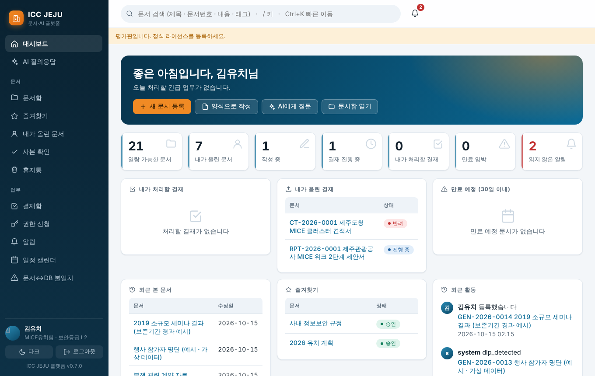
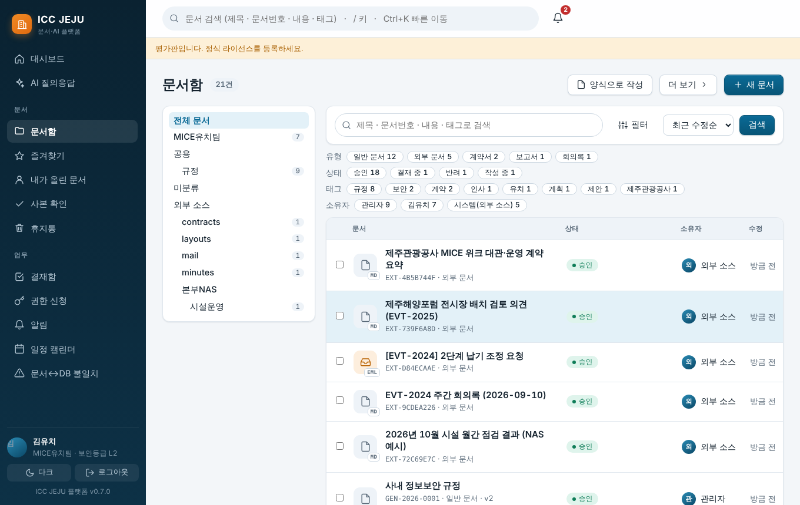
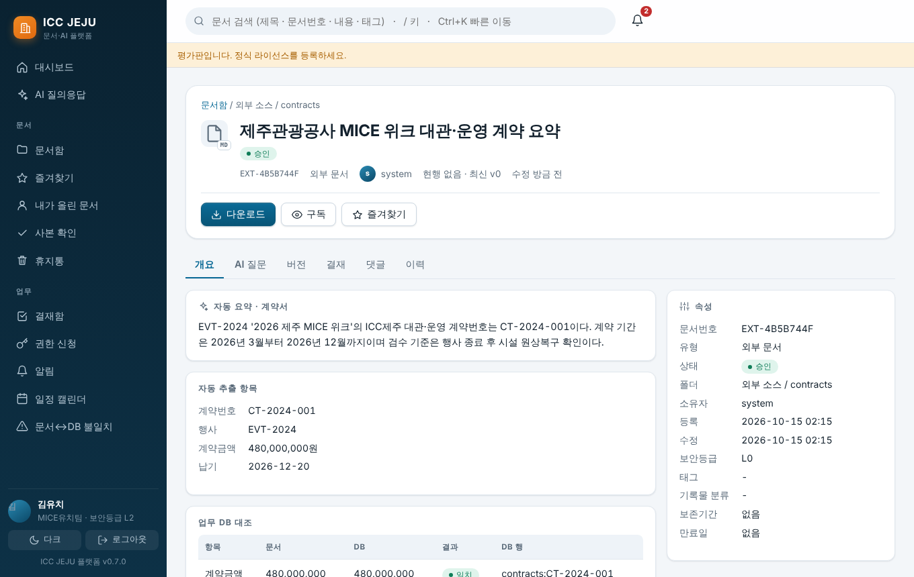
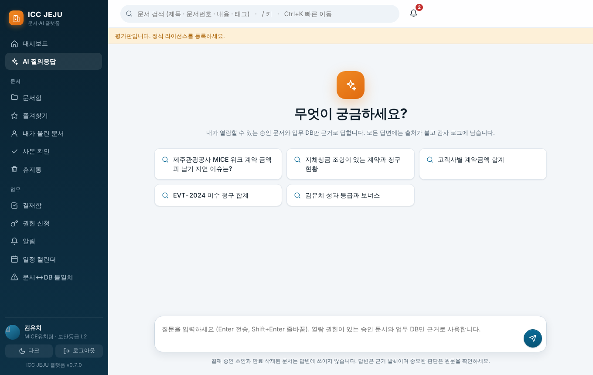
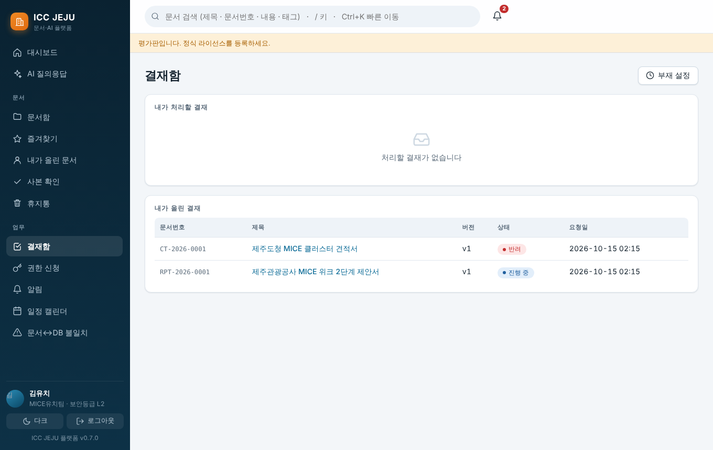
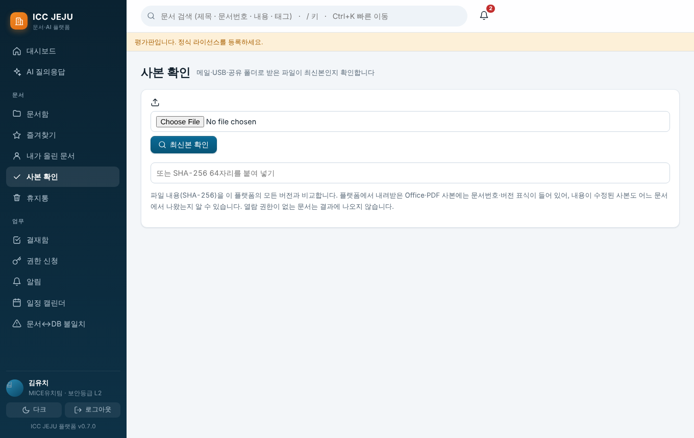
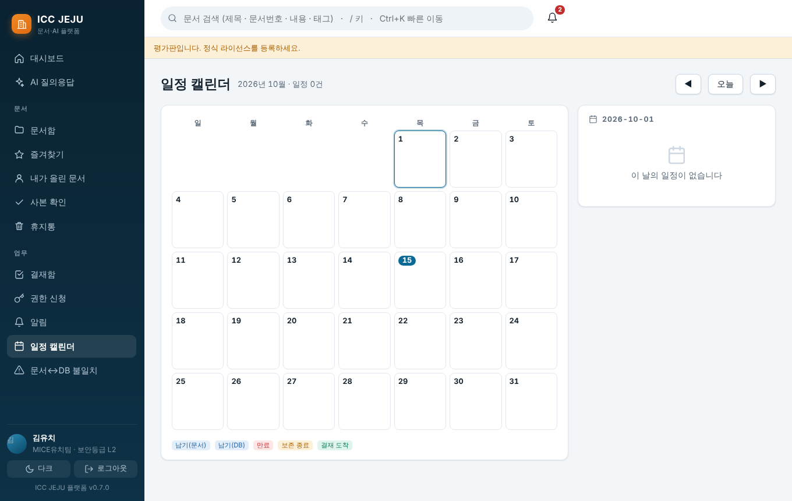
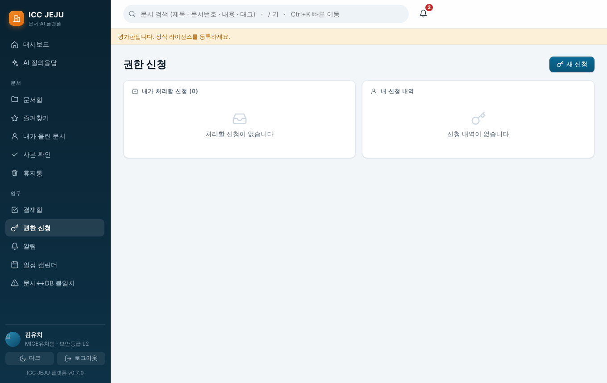

# ICC JEJU 문서·AI 플랫폼 — 사용자 매뉴얼 (v0.7)

일반 사용자(직원)용 안내입니다. 화면 이미지는 데모 데이터 기준이며 `tools/make_manual_shots.js` 로 다시 만들 수 있습니다.

## 1. 시작하기
- 브라우저로 서버 주소(예: `http://서버IP:8080`)에 접속해 로그인합니다(운영: SSO/토큰, 데모: 사용자 선택).
- 왼쪽 메뉴에서 이동하고, 상단 검색창(`/` 키)으로 문서를 찾습니다. `Ctrl+K` 는 빠른 이동(메뉴·문서) 입니다.

대시보드에는 내가 처리할 결재, 내가 올린 문서, 만료 예정 문서, 최근 본 문서가 모입니다.

## 2. 문서 찾기와 올리기

- **검색**: 제목·문서번호·내용·태그. 권한이 있는 문서만 나옵니다.
- **자연어로 찾기**(더 보기 ▸): "내가 올린 승인된 계약서 최근 30일 지체상금"처럼 쓰면 이해한 조건이 칩으로 표시됩니다.
- **새 문서**: 파일을 고르고 문서유형·폴더를 지정합니다. 유형에 따라 **사용자 정의 항목**(거래처, 금액 등)이 나타나며 필수 항목(*)은 반드시 입력합니다. 한글(HWP/HWPX)·Word·Excel·PowerPoint·PDF·메일(.eml/.msg)의 본문은 자동으로 읽어 검색에 쓰입니다. 스캔 PDF는 파일만 보관하고 본문은 읽지 못할 수 있습니다.
- **ZIP 일괄 등록**, **목록 CSV 내보내기**, **양식으로 작성**(템플릿)도 "더 보기"에 있습니다.
- 개인정보(주민번호·카드·연락처 등)가 검출되면 등록 직후 알림이 오고, 정책에 따라 보안등급이 올라가거나 등록이 거부될 수 있습니다.

## 3. 문서 상세

| 탭 | 내용 |
|---|---|
| 개요 | 본문 미리보기, 메타데이터, 분류·보존 |
| AI 질문 | 이 문서만 대상으로 질문 (근거 문장 표시) |
| 버전 | 버전 목록, 새 버전 올리기, 복원, A↔B 비교와 **변경 요약**(금액·날짜·항목) |
| 결재 | 결재 요청·승인·반려·위임·회수 |
| 댓글 | 댓글·@멘션 |
| 권한 | 폴더 상속 / 직접 지정 (관리 권한자) |
| 외부 공유 | 로그인 없이 보는 링크 (유효기간·비밀번호·다운로드 횟수), **"항상 최신본"** 옵션, **메일로 보내기**(받는 사람마다 별도 링크) |
| 열람 현황 | 누가 언제 열람·다운로드했는지 (편집 권한자) |
| 조항 점검 | 계약서의 표준 조항 누락을 키워드로 점검 (법적 판단 아님) |
| 이력 | 모든 변경 기록 |

- **개인정보 가림**: 화면에는 가려서 보입니다. 필요하면 "원문 보기(사유 필수)" — 사유와 열람자가 기록되고 소유자에게 알림이 갑니다.
- **체크아웃**: 편집 중 다른 사람의 덮어쓰기를 막습니다. **다운로드 제한** 문서는 화면 열람만 가능합니다.
- **즐겨찾기·구독**: 구독한 문서가 바뀌면 알림이 옵니다.

## 4. AI 질의응답

질문하면 **내가 볼 수 있는 문서만** 근거로 답하고, 근거 문서를 함께 보여줍니다. 근거가 없으면 "찾을 수 없다"고 답합니다(지어내지 않음). 숫자는 근거에 있는 값만 인용합니다.

## 5. 결재

- **결재 요청**: 결재자 선택(순차/병렬), **저장된 결재선 불러오기**, **참조**(알림만 받는 사람) 지정, 결재선 저장.
- **부재 설정**: 결재함 상단 "부재 설정"으로 대결자와 기간을 지정하면, 부재 중 내게 온 결재가 대결자에게 넘어가고 이력에 "대결"로 남습니다.
- 본인이 요청한 결재는 승인할 수 없고, 반려에는 사유가 필요합니다.

## 6. 사본 확인

메일·USB로 받은 파일이 **최신본인지** 확인합니다. 파일을 올리거나 SHA-256 을 붙여 넣으면 *최신본 / 이전 버전 / 수정된 사본 / 찾을 수 없음* 으로 알려 줍니다(권한 있는 문서만).

## 7. 일정·권한 신청

- 캘린더: 만료·보존·행사 일정 확인.
- 읽을 수 없는 문서는 존재 자체가 보이지 않습니다. 필요하면 **권한 신청**으로 담당자에게 요청합니다.

## 8. 자주 묻는 질문
- **검색에 안 나와요** → 권한이 없거나(보이지 않는 것이 정상), 결재 전 초안이거나, 만료된 문서일 수 있습니다.
- **다운로드가 안 돼요** → "다운로드 제한" 문서이거나 보안정책입니다. 소유자에게 문의하세요.
- **받은 파일이 최신인지 모르겠어요** → "사본 확인"을 사용하세요.
